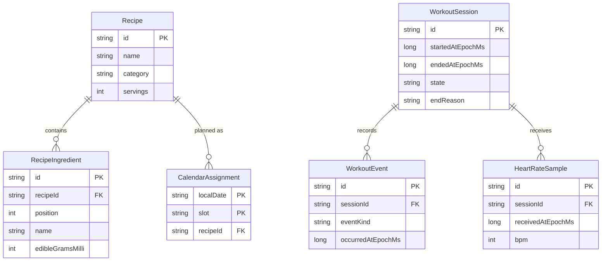

# t6 — Private local persistence and health-data boundaries

## Decision

Use an encrypted, versioned Room database backed by SQLCipher for personal records, with a random per-install database key protected by the Android Keystore. Keep Health Connect read-only and query steps on demand without copying them into Nutria's database. Persist BLE workout sessions and only the timestamped heart-rate notifications actually received; never fill gaps, derive unrequested metrics, or upload this data. Do not back up or synchronize the local records by default.

The existing browser `nutria.v1` value is not imported or changed. The Android app starts with its own local store; the PWA remains available with its browser data until a separately approved, explicit transfer design exists.

## Persistence ownership

| Store | Contents | Boundary |
|---|---|---|
| Encrypted Room / SQLCipher | Nutrition goals; meal entries; water events; recipes and ingredients; calendar assignments; cycle settings, periods and daily journal; workout sessions, lifecycle events and received HR samples | App-private device storage; encrypted database; no automatic backup, sync, API upload, or cross-app access. |
| DataStore | Non-health display / connection preferences: theme (`sage`, `ocean`, `lavender`, or `coral`), recommendation filters, optional third-meal setting, and Nutria service base URL | App-private and excluded from backup; no API credential or user record. No additional application-level encryption; do not put cycle, diary, or workout data here. Restrict base URLs to valid HTTPS in release builds; local HTTP is debug-only. |
| Android Health Connect | Source of daily step records | Nutria requests only `READ_STEPS`, computes an aggregate for the current local day, and keeps the result in transient UI state with its refresh time. No Health Connect rows or cached step total are written to Room. |
| BLE band | Source of actual heart-rate notifications while connected | Scan/device details are transient. Locally persist workout timestamps, interruption markers, and received BPM samples only. Do not persist a Bluetooth address, scan history, advertising payload, or vendor identifier by default. |
| Existing Nutria service | Explicit photo-analysis request and explicit ingredient-search query only | Preserve the frozen routes. The photo and query are sent only after the relevant user action; no diary, cycle, step, workout, band, or Health Connect data is sent. The OpenAI key remains server-side. |

`viewMonth`, current Health Connect permission state, BLE connection state, search results, image URI/bytes, pending API response, and current screen state are transient; they are not user-record tables. A successfully analyzed meal stores only the resulting meal fields, never the source photo or raw API response. Ingredient lookup results are transient until the user selects an ingredient to save in a recipe.

## Proposed local model

Identifiers are opaque UUIDs. Use `snake_case` for SQL table/column names and idiomatic `camelCase` Kotlin properties. Store local calendar dates as ISO `YYYY-MM-DD` strings, not UTC timestamps. Store event instants as epoch milliseconds; capture the local date when the user creates the record so time-zone changes do not silently move a meal, water event, plan, cycle record, or workout to another day. Use a device `ZoneId` snapshot for workout presentation. Do not use a fixed 24-hour duration to compute a local day: resolve local midnight and the following local midnight in the current zone, including DST changes.

Store nutrients as nonnegative scaled integers (milli-kcal / milli-grams) and water as integer millilitres; convert/round at the same UI boundaries as the PWA. Store ingredient amount/unit as user-facing values plus normalized edible grams. Treat recipe-linked diary entries as immutable nutrition/name snapshots, not live recipe references, so editing or deleting a recipe cannot rewrite diary history.

| Table | Key fields and constraints | Relationships, indexes, and behavior |
|---|---|---|
| `nutrition_goals` | Singleton `id=1`; calories, water ml, protein, carbohydrate, and fat targets. Positive goal checks. Preserve PWA defaults: 2,000 kcal, 2,000 ml, 120 g protein, 250 g carbohydrates, 65 g fat. | Encrypted Room because goals are health-related. |
| `meal_entries` | `id` PK; `local_date`; name; calories and macros for the logged portion; source enum `food`, `recipe`, `photo`; `created_at_epoch_ms`. Nutrient values are nonnegative. | No FK to recipe: history remains intact when recipes are deleted. Index `(local_date, created_at_epoch_ms)` for daily summary/history. |
| `water_events` | `id` PK; `local_date`; positive `amount_ml`; `sequence_no`; `created_at_epoch_ms`. | Allocate `sequence_no` transactionally and uniquely per local date; undo deletes the highest sequence, even if timestamps tie. Index `(local_date, sequence_no)`. “Clear today” deletes only today's meals and water events, in one transaction. |
| `recipes` | `id` PK; optional recommendation ID; name; category `meal`/`dinner`; positive servings; recipe totals; optional preparation time, complexity, instructions. | Static recommendations remain code/catalog data until saved. |
| `recipe_ingredients` | `id` PK; `recipe_id` FK; position; name; entered amount/unit; normalized edible grams; per-100-g nutrition. | Unique `(recipe_id, position)`; FK to `recipes` with delete cascade. Recipe deletion removes ingredient rows. |
| `calendar_assignments` | Composite PK `(local_date, slot)` where slot is `meal`, `dinner`, or optional `breakfast`; `recipe_id` FK. | FK to `recipes` with delete cascade, matching the current behavior that removes a deleted recipe's assignments. Index `recipe_id`. Monthly view selection and the third-meal toggle are not assignment rows. |
| `cycle_settings` | Singleton `id=1`; cycle and period average days. Enforce existing ranges (21–45 and 2–10), with period length less than cycle length. | Encrypted Room; use validated repository writes. |
| `period_records` | `id` PK; start local date; optional end local date, not earlier than start. | Unique start date; validate overlap and ordering transactionally according to the existing cycle contract. |
| `cycle_days` | `local_date` PK; flow enum; pain 0–10; mood enum; optional note of at most 160 characters. | Replaces the date-keyed journal item; notes are reproductive-health data and stay inside encrypted Room. |
| `workout_sessions` | `id` PK; start/end instants; start local date and zone; state `active`, `interrupted`, or `completed`; end/interruption reason. | Index `(local_date, started_at_epoch_ms)`. A lost connection changes visible state; it does not create samples or imply continuous capture. |
| `workout_events` | `id` PK; `session_id` FK; event kind and observed instant. Kinds include user start/stop, link lost, explicit reconnect, Bluetooth off, permission loss, and foreground recovery detection. | FK to `workout_sessions` with delete cascade; index `(session_id, occurred_at_epoch_ms)`. Persist observed times only; don't backdate an unobserved interruption. |
| `heart_rate_samples` | `id` PK; `session_id` FK; `received_at_epoch_ms`; BPM parsed from a received standard Heart Rate Measurement notification. | FK to `workout_sessions` with delete cascade; index `(session_id, received_at_epoch_ms)`. No interpolation, Health Connect fallback, or calorie/exercise-minute calculation. |

### ER diagram

<!-- mermaid-checked: every attribute is `<type> <name> [<key>] ["<description>"]` with at most one of PK/FK/UK, no \n in descriptions, no {} in descriptions, every relationship label is double-quoted -->

The diagram omits date-keyed meal, water, period, and cycle tables because their `local_date` values are domain keys, not foreign keys to a synthetic day row. It also omits `nutrition_goals` and `cycle_settings` singleton rows.

## Constraints and transaction boundaries

- Keep all current behavior while normalizing into rows: meal totals remain snapshots; water undo removes exactly the latest event; recipe totals derive from ingredient per-100-g values and normalized edible grams; calendar slots refer only to saved recipes.
- Enforce numeric ranges and enum validity in the domain/repository and, where SQLite supports an equivalent constraint, in the schema as defense in depth. Preserve current validation messages and Spanish formatting at the UI boundary.
- Use a transaction for clearing today's meals and water, deleting a recipe and its assignments/ingredients, saving a multi-ingredient recipe, updating cycle settings, and recording a workout state transition with its event. Never include unrelated settings, plans, or cycle rows in “clear today.”
- Make workout sample writes append-only and tied to a durable session ID. On link loss, append an observed event and mark the session interrupted; only explicitly received samples are insertable. On process death, mark an open session interrupted on recovery and show an unknown gap start if it was not observed.
- Do not cache an empty Health Connect response as numeric zero. Preserve the repository result as `Available(count, fetchedAt)` versus `NoData`, `PermissionRequired`, `ProviderUnavailable`, or `ReadError`; the UI must not invent a count.

## Encryption, key lifecycle, and recovery

1. Use SQLCipher's supported Room integration for full database encryption; pin and verify mutually compatible Room, SQLCipher, Android Gradle Plugin, and native ABI versions during implementation. SQLCipher is a new native dependency, so include its native-library packaging, upgrade, and supported-device checks in the build gate.
2. Generate a cryptographically random 256-bit database passphrase once per installation. Wrap it using an AES-GCM key generated in Android Keystore; Keystore key material stays non-exportable. Persist only the wrapped passphrase and nonce in app-private no-backup storage. Unwrap only to a short-lived in-memory buffer when opening the database, and clear the buffer as soon as practical. Do not hardcode a DB password, use a human password as the SQLCipher key, place key material in DataStore/SharedPreferences/BuildConfig, or log it.
3. Use a non-exportable Keystore key; StrongBox may be preferred only when supported and must fall back safely. Never depend on a StrongBox-only device feature. The app process necessarily has database access while running; encryption at rest does not protect data from a compromised, unlocked app/device.
4. If the Keystore alias is missing/invalidated or the encrypted DB cannot be opened, fail closed: do not auto-delete, recreate, downgrade, or silently clear records. Explain the recovery limitation in Spanish and offer destructive reset only after explicit user confirmation. Because backups/transfers are disabled, there is no recovery key or automatic cross-device restore.
5. Apply schema changes through ordered Room `Migration` steps. Keep migrations transaction-safe and safe to re-enter where their operations allow; test each supported old-schema fixture and interrupted-upgrade recovery. Do not use destructive migration fallback. A future key rotation is separate from a Room schema migration and must use verified re-encryption/atomic replacement with rollback evidence.

## Backup, retention, and deletion

Set `android:allowBackup="false"` and provide explicit legacy `fullBackupContent` plus API 31+ `dataExtractionRules` that exclude app data from both cloud backup and device-to-device transfer. Android documentation cautions that `allowBackup=false` may not disable device-to-device transfer on some Android 12+ manufacturers, so rules and device-level validation are required. Place the encrypted DB, wrapped-key envelope, and settings file in private storage and exclude all related files/sidecars. Keep sensitive data out of cache, external/shared storage, logs, crash reports, analytics, notifications, and screenshots where feasible.

Keep records until the user deletes them; do not silently expire nutrition, cycle, or workout history. Provide an explicit delete-workout action that removes the session, its samples, and its events in one transaction. A confirmed “clear today” affects only today's food and water, preserving recipes, calendar plans, cycle records, goals, settings, and workouts. App uninstall/device loss may permanently remove this local-only data; disclose that before use. Export, import, cloud backup, and synchronization are not part of this design.

## Health Connect and BLE boundary

### Steps

- Request only `READ_STEPS`, at the user's request; do not request background-read permission, `WRITE_STEPS`, other health record types, or read heart rate from Health Connect.
- Check provider availability and permission at read time. Aggregate `StepsRecord.COUNT_TOTAL` over local-day start and next local-day start, with no `DataOrigin` filter so available provider/device sources can contribute. Do not hardcode the post-June-2026 device-specific source identifier.
- Do not persist a copy, raw record, source identifier, or cached count. Show `Health Connect` as the source, last refresh time, and explicit unavailable/permission/no-data/error states. A foreground read and explicit refresh are sufficient for this product; no Health Connect background read is designed.
- Explain in Spanish that Health Connect owns the step records and Nutria reads the daily total on-device only; Nutria neither writes to Health Connect nor sends step values to its server.

### Band workouts

- Only connect after an explicit user action and accept a band exposing the standard Heart Rate service/measurement characteristic. Do not store a MAC address or continuously scan in the background. Request only Bluetooth permissions required by the supported Android versions.
- Start/stop is user-controlled. Persist session metadata, actual received BPM values and observed connection/lifecycle events in encrypted Room. Do not store scan payloads, names/addresses unless a later user-facing feature requires it, raw GATT packets, or a simulated value.
- A disconnect, Bluetooth-off, lost permission, or process/lifecycle interruption adds an interruption marker when observed, marks readings stale, and leaves a visible gap. Never interpolate, infer continuous monitoring, or derive calories/exercise minutes. Reconnection is explicit; only new notifications after reconnection can be recorded.
- State clearly that samples remain in Nutria's private local store, are not written to Health Connect or sent to a server, and may be lost on uninstall/reset. Do not treat pairing or a GATT connection as a workout until the user starts one.

### User-facing disclosure baseline (Spanish)

> Tus comidas, agua, recetas, plan, datos del ciclo y entrenamientos se guardan en el almacenamiento privado de Nutria en este dispositivo. No se sincronizan ni se respaldan automáticamente; podrían perderse al desinstalar la app o cambiar/restablecer el dispositivo.
>
> Si lo autorizas, Nutria lee de Health Connect el total de pasos del día; no lo modifica ni lo envía a nuestros servidores. Durante un entrenamiento iniciado por ti, Nutria guarda localmente solo las lecturas de pulso recibidas de la banda BLE y marca las interrupciones; no inventa lecturas ni envía estos datos.
>
> El análisis de una foto y la búsqueda de un ingrediente son acciones separadas: la foto elegida se envía al servicio Nutria para su análisis y la consulta de ingrediente se envía al servicio para buscar productos. No se envían tu diario, ciclo, pasos ni entrenamientos. La clave de OpenAI permanece en el servidor.

Keep API disclosure adjacent to the explicit submit/search action and consistent with the existing server contracts; this text does not authorize silent uploads or change those contracts.

## Data classification and controls

| Data | Classification | Storage / controls |
|---|---|---|
| Meals, nutrition goals, recipes and plans | Personal, health-adjacent | Encrypted Room; app-private; no backup, synchronization, or remote logging. |
| Period dates, symptoms and notes | Highly sensitive reproductive-health information | Encrypted Room; no server or Health Connect transfer; no backup; no note text in logs/notifications. |
| Workout timestamps and received heart rate | Sensitive physiological/health data | Encrypted Room; actual samples only; no device identifier or derived metrics by default; no backup or remote transfer. |
| Health Connect steps | Sensitive health data controlled by Health Connect | Not copied to persistent Nutria storage; `READ_STEPS` only; aggregate stays transient in memory. |
| Display preferences and service base URL | Preferences / connection metadata | App-private DataStore; no credentials; excluded from backup. |
| Name, email, address, payment card | Not collected by current data model | No account/PII or PCI fields are introduced by this design. |

“Health data” here is a product sensitivity classification, not a claim that Nutria is a HIPAA-covered entity or that the records are legally classified as HIPAA PHI. No field-level access control or app-level login is present in the current product. DataStore preferences are not application-encrypted and are limited to non-health settings; the principal sensitive-record controls are app sandboxing, encrypted local DB, Keystore-protected key, least-privilege Health Connect access, no-backup rules, and explicit remote actions.

## Schema migration and compatibility

- Start with a new Android database schema version; no existing Android database or server database exists. Do not treat browser `nutria.v1` as a migration source.
- Preserve the old PWA data untouched in its browser profile. No automatic import, browser-origin access, or PWA deletion is part of this task.
- If an explicit import is approved later, make it a separate user-initiated, disclosed operation: parse/validate before writing, show a preview and conflicts, preserve all valid records, commit the import atomically, make repeat imports idempotent, and retain the original PWA data. Test orphan calendar recipe references, invalid date/numeric values, duplicate IDs, and partially malformed records before deciding whether to reject or quarantine rows.
- Never introduce backend tables, health endpoints, authentication, synchronization, or changes to `/api/analyze-meal` and `/api/ingredients/search` as part of the local model.

## Risks and required gates

| Risk | Required gate |
|---|---|
| SQLCipher adds native binaries and a key-management dependency | Validate Room integration, minSdk/ABI packaging, application startup and encrypted database reopen/upgrade on supported Android devices before release. |
| Keystore key loss makes the DB unreadable | Exercise missing/invalidated key state; verify fail-closed behavior and explicit, warned reset without silent data loss. |
| Backup rules differ by Android version/OEM | Verify cloud backup and device-to-device transfer exclusions on API 30 and API 31+ devices; `allowBackup=false` alone is not sufficient evidence. |
| Local-only data has no recovery path | Make no-backup/uninstall-loss disclosure visible; any future export/restore requires its own approved consent and threat-model design. |
| Health Connect may have no records or permission/provider failures | Test provider unavailable, permission grant/denial/revocation, no-data, actual aggregate, and query error; assert no `null → 0` substitution. |
| BLE data may stop while a workout appears active | Test unsupported band, missing service/characteristic, Bluetooth-off, permission loss, disconnect, stale reading, foreground return, process death, and explicit reconnect/stop; assert gaps and only actual samples persist. |

## Upstream Artifacts Consumed

- `.github/modernize/rearchitecture/artifacts/t1-pm-spec.md` — REQ-006 clear-today isolation; REQ-015 cycle-note privacy; REQ-021–REQ-026 Health Connect, BLE lifecycle, persistence and disclosure criteria.
- `.github/modernize/rearchitecture/artifacts/t2-architect.md` — current `nutria.v1` storage boundary, no existing server database/account/sync, and source inventory.
- `.github/modernize/rearchitecture/artifacts/data-model.md` — exact browser-local entity/field inventory and absence of an import/export path.
- `.github/modernize/rearchitecture/artifacts/constitution.md` — local/private data, no implicit backup/sync, frozen server contracts, no PWA removal, and evidence requirements.
- `.github/modernize/rearchitecture/artifacts/t4-architect.md` — Room/DataStore split, feature state ownership, Health Connect read flow, BLE workout lifecycle, and explicit assignment of encryption/key/migration choices to t6.
- `.github/modernize/rearchitecture/board.md` — task order and t4 design handoff. No `context.md`, `decisions.md`, project-topology path, `*-fanout.md`, or existing DBA log was present; `architecture_index.md` and `data-model.md` were used as the available topology/state fallback.

## Evidence Mapping

- `t1-pm-spec.md#REQ-006` → transactional meal/water clearing that leaves recipes, plans, cycles and settings untouched.
- `t1-pm-spec.md#REQ-015` and `#Data, Privacy, and Current Product Boundaries` → encrypted cycle journal, local-only notes, no automatic transfer.
- `t1-pm-spec.md#REQ-021–REQ-023` → Health Connect `READ_STEPS`-only, aggregate per local day, transient results, explicit permission/no-data/unavailable/error states.
- `t1-pm-spec.md#REQ-024–REQ-026` → workout/session/sample/event schema, actual BPM only, gap markers, no fabricated metrics, local-data disclosure.
- `data-model.md#Persistence boundary` and `#State inventory` → row mapping for existing `nutria.v1` domains; no automatic import; PWA records remain untouched.
- `t4-architect.md#Local privacy boundary` and `#State and contract ownership by feature` → encrypted Room records, non-health DataStore preferences, read-only Health Connect, BLE-only HR collection, no server storage.
- `constitution.md#Principle III` and `#Additional Constraints` → backup/transfer exclusions and prohibited implicit synchronization.
- `t4-architect.md#Nutria API - frozen server seam` → only user-triggered photo/ingredient API data may leave the device; server-side OpenAI key remains unchanged.

## Verification

- Data model review: all existing persisted PWA domains are represented; static recommendations, transient query/photo state and Health Connect values are intentionally not persisted.
- Diagram safety review: Mermaid ER syntax follows the loaded `data-architecture` skill subset; the required attestation is present; no external/platform source is represented as a Room relationship.
- Structural check: final PowerShell validation covered required sections, upstream/evidence headings, key privacy and data-boundary statements, artifact/log/learning presence, one attested Mermaid block, 25 safe attribute lines, and 4 quoted relationship lines; 16 checks passed, 0 failed.
- Runtime/build tests: not applicable to this documentation-only design task; the assigned host has no Android SDK/Gradle/ADB and this artifact does not claim native build or device verification.

## Sources

- Android Developers, [Health Connect: Read data](https://developer.android.com/health-and-fitness/health-connect/read-data) — aggregate cumulative step records, foreground/background access, and current device-step attribution behavior (accessed 2026-11-14).
- Android Developers, [Android Keystore system](https://developer.android.com/privacy-and-security/keystore) — non-exportable key material and supported key-use controls (accessed 2026-11-14).
- Android Developers, [Auto Backup for Apps](https://developer.android.com/identity/data/autobackup) — app-private database backup defaults, no-backup directory, extraction rules, and device-transfer caveat (accessed 2026-11-14).
- SQLCipher for Android, [Room integration](https://github.com/sqlcipher/sqlcipher-android#sqlcipher-for-android-room-integration) — Room 2/Room 3 integration and native library loading (accessed 2026-11-14).
